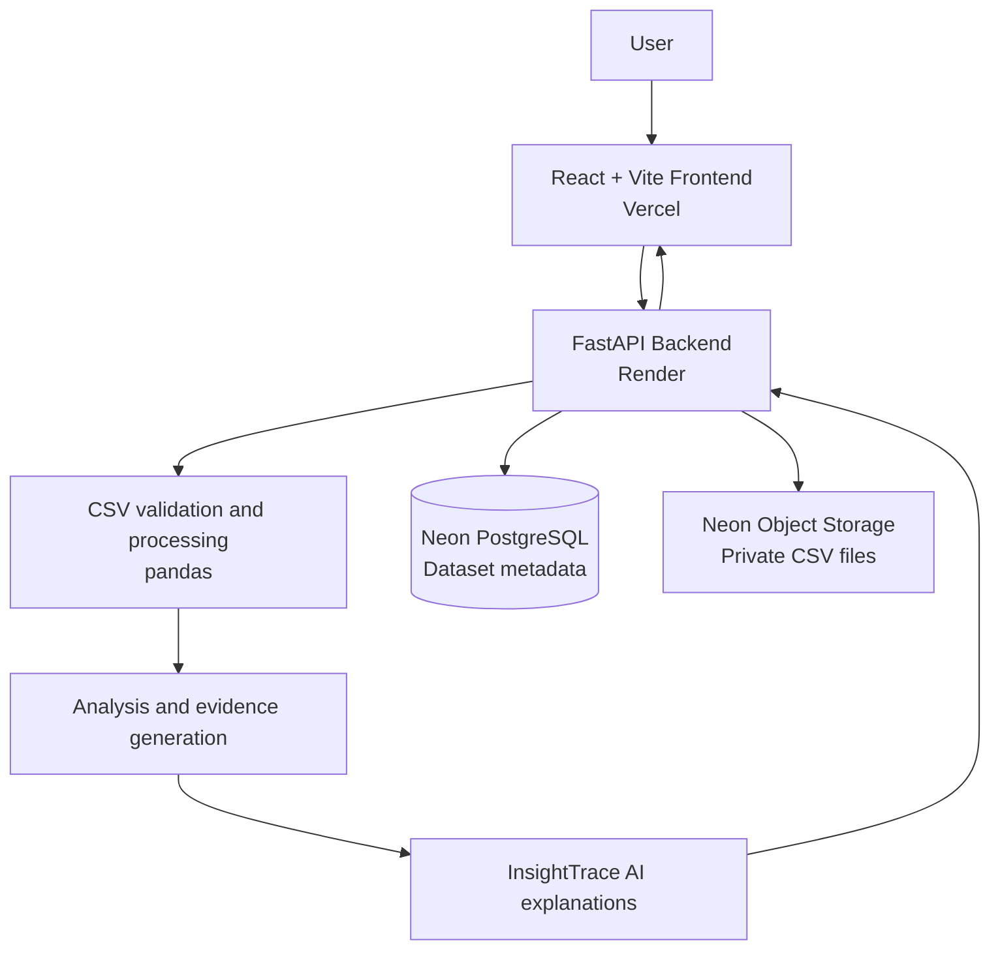

<div align="center">

# InsightTrace AI
### AI-Powered Business Intelligence Platform

**Turn raw CSV data into clear analysis, actionable insights, and downloadable reports.**

<p>
  <a href="https://ai-business-intelligence-platform-opal.vercel.app/">
    
  </a>
  <a href="https://github.com/KavyaRaghuvanshi/AI-Business-Intelligence-Platform">
    
  </a>
  <a href="https://ai-business-intelligence-platform-zkre.onrender.com/docs">
    
  </a>
</p>

<p>
  
  
  
  
  
  
</p>

</div>

---

## Overview

**InsightTrace AI** is a web-based Business Intelligence (BI) platform that helps users explore business datasets without having to manually inspect every row. Upload a CSV file, preview its contents, review statistical analysis, and generate evidence-based findings with AI-assisted explanations.

The application uses a React frontend, a FastAPI backend, Neon PostgreSQL for dataset metadata, and private Neon Object Storage for uploaded CSV files. The storage integration keeps uploaded files separate from the Render application filesystem, so datasets remain available after backend restarts and redeployments.

## Live Application

| Resource | Link |
|---|---|
| **Web application** | [Open InsightTrace AI](https://ai-business-intelligence-platform-opal.vercel.app/) |
| **Backend API** | [Open API](https://ai-business-intelligence-platform-zkre.onrender.com/) |
| **Interactive API docs** | [Swagger UI](https://ai-business-intelligence-platform-zkre.onrender.com/docs) |
| **Source code** | [GitHub repository](https://github.com/KavyaRaghuvanshi/AI-Business-Intelligence-Platform) |

> **Deployment note:** The application uses free-tier hosting services. A free backend may take a short time to respond after an idle period, and storage/database services have usage limits. Availability and limits depend on the providers' current plans.

## Key Features

### Dataset workspace
- Upload CSV datasets from the web interface.
- Store uploaded CSV files in a private Neon Object Storage bucket.
- Save dataset metadata and object references in Neon PostgreSQL.
- Browse and search the dataset library.
- Preview the first rows and inspect dataset columns.
- Download the original CSV and a JSON analysis report.

### Data analysis
- View row and column counts.
- Identify missing values by column.
- Detect duplicate rows.
- Inspect column data types.
- Review numeric summaries, including mean, minimum, and maximum values.

### AI-powered insights
- Generate evidence-based findings from a dataset.
- Review findings related to missing values, numeric patterns, and potential outliers.
- Use **InsightTrace AI** to produce explanatory context and recommendations for generated findings.

### Application and API
- React-based user interface.
- FastAPI endpoints for dataset operations and analysis.
- User registration and login endpoints are included in the backend.
- Interactive API documentation through Swagger UI.

## How It Works



### Dataset upload and retrieval flow

1. A user selects a CSV file in the React application.
2. The frontend sends the file to the FastAPI upload endpoint.
3. The backend validates the file and uploads it to the private Neon Object Storage bucket.
4. The backend stores the dataset name and its `neon://` object reference in PostgreSQL.
5. When the user opens preview, analysis, insights, or export, the backend retrieves the CSV from Object Storage and processes it.

**Why use Object Storage?** Render's local filesystem on a free web service is not persistent. Keeping the CSV files in Neon Object Storage prevents uploaded files from disappearing when the backend restarts or redeploys.

## Technology Stack

| Layer | Technologies |
|---|---|
| Frontend | React, JavaScript, Vite, CSS, Lucide React |
| Backend | Python, FastAPI, Uvicorn |
| Data processing | pandas |
| Database | Neon PostgreSQL, SQLAlchemy |
| File storage | Neon Object Storage (S3-compatible API), boto3 |
| Authentication utilities | JWT-based token utilities, password hashing |
| Deployment | Vercel (frontend), Render (backend), Neon (database and object storage) |

## API Reference

The deployed Swagger page contains the interactive and current API schema: [Open Swagger UI](https://ai-business-intelligence-platform-zkre.onrender.com/docs).

| Method | Endpoint | Purpose |
|---|---|---|
| `GET` | `/` | Check that the API is running |
| `GET` | `/dashboard` | Retrieve dashboard counts |
| `POST` | `/datasets/upload` | Upload a CSV dataset |
| `GET` | `/datasets` | List registered datasets |
| `GET` | `/datasets/{id}/preview` | Preview dataset rows and columns |
| `GET` | `/datasets/{id}/analysis` | Retrieve statistical analysis |
| `GET` | `/datasets/{id}/insights` | Generate evidence-based insights |
| `GET` | `/datasets/{id}/insighttrace` | Retrieve InsightTrace AI explanations |
| `GET` | `/datasets/{id}/export/csv` | Download the original CSV |
| `POST` | `/datasets/demo/register` | Register available demo datasets |
| `GET` | `/storage/health` | Check Neon Object Storage connectivity |
| `POST` | `/users` | Register a user |
| `POST` | `/login` | Authenticate a user |
| `GET` | `/me` | Retrieve the authenticated user's profile |

Replace `{id}` with the dataset ID returned by `GET /datasets`.

## Run Locally

### Prerequisites

- Python 3.11 recommended for the backend environment.
- Node.js and npm.
- A Neon project with a PostgreSQL database.
- A private Neon Object Storage bucket and S3-compatible credentials.
- Git.

### 1. Clone the repository

```bash
git clone https://github.com/KavyaRaghuvanshi/AI-Business-Intelligence-Platform.git
cd AI-Business-Intelligence-Platform
```

### 2. Configure the backend

Open a terminal in the `backend` directory:

```bash
cd backend
python -m venv venv
```

Activate the virtual environment.

**Windows PowerShell:**

```powershell
.\venv\Scripts\Activate.ps1
```

**macOS/Linux:**

```bash
source venv/bin/activate
```

Install the dependencies:

```bash
pip install -r requirements.txt
```

Create `backend/.env` and add your own values:

```env
DATABASE_URL=your_neon_postgresql_connection_string

AWS_ENDPOINT_URL_S3=your_neon_s3_endpoint
AWS_ACCESS_KEY_ID=your_neon_storage_access_key_id
AWS_SECRET_ACCESS_KEY=your_neon_storage_secret_access_key
AWS_REGION=your_neon_storage_region
NEON_STORAGE_BUCKET=your_private_bucket_name

CORS_ORIGINS=http://localhost:5173,http://127.0.0.1:5173
MAX_UPLOAD_SIZE_MB=25
```

Use the **Storage** connection details supplied by Neon for the S3 endpoint, credentials, and region. Do not use the PostgreSQL hostname as the S3 endpoint. Keep the bucket private.

> Never commit `.env` files, database connection strings, access keys, secret keys, or JWT secrets to GitHub. Use your own credentials locally and configure production secrets in the hosting provider's environment settings.

Start the backend from the `backend` directory:

```bash
python -m uvicorn app.main:app --reload
```

The local API should be available at `http://127.0.0.1:8000`, with Swagger UI at `http://127.0.0.1:8000/docs`.

### 3. Configure the frontend

Open a second terminal:

```bash
cd frontend/my-app
npm install
```

Configure the frontend API base URL using the environment-variable name or configuration already used in `src/services/api.js`. For local development, it should point to:

```text
http://127.0.0.1:8000
```

Start the Vite development server:

```bash
npm run dev
```

Vite will print the local frontend URL in the terminal (commonly `http://localhost:5173`).

### 4. Verify storage connectivity

With the backend running and its environment variables configured, open:

```text
http://127.0.0.1:8000/storage/health
```

A successful response should indicate that Neon Object Storage is connected and identify the configured bucket.

## Environment Variables

| Variable | Description |
|---|---|
| `DATABASE_URL` | Neon PostgreSQL connection string used by the backend |
| `AWS_ENDPOINT_URL_S3` | Neon Object Storage S3-compatible endpoint |
| `AWS_ACCESS_KEY_ID` | Neon Object Storage access key ID |
| `AWS_SECRET_ACCESS_KEY` | Neon Object Storage secret access key |
| `AWS_REGION` | Region shown in Neon's Storage connection details |
| `NEON_STORAGE_BUCKET` | Name of the private Object Storage bucket |
| `CORS_ORIGINS` | Comma-separated frontend origins permitted by the API |
| `MAX_UPLOAD_SIZE_MB` | Maximum CSV upload size in megabytes (defaults to 25 in the backend) |

The backend may also require the authentication/secret settings defined in its security configuration. Keep those values private and configure them in the backend environment.

## Deployment

The deployed project uses the following services:

- **Frontend — Vercel:** hosts the React/Vite application.
- **Backend — Render:** hosts the FastAPI application.
- **Database — Neon PostgreSQL:** stores application and dataset metadata.
- **File storage — Neon Object Storage:** stores uploaded CSV files in a private bucket.

For a new deployment, configure the backend environment variables in Render and set the frontend's API base URL to the deployed Render backend. Configure CORS to allow the deployed Vercel origin. Never put Neon storage credentials in frontend environment variables.

## Repository Structure

```text
AI-Business-Intelligence-Platform/
├── backend/
│   ├── app/
│   │   ├── main.py                 # FastAPI application and API routes
│   │   ├── storage.py              # Neon Object Storage integration
│   │   ├── insight_engine.py       # Evidence and insight generation
│   │   └── ai_explaner.py          # AI explanations for findings
│   ├── uploads/                    # Local development upload directory
│   ├── database.py                 # SQLAlchemy database setup
│   ├── models.py                   # Database models
│   ├── schemas.py                  # Request/response schemas
│   ├── security.py                 # Authentication and password utilities
│   └── requirements.txt            # Python dependencies
├── frontend/
│   └── my-app/
│       ├── src/
│       │   ├── pages/              # Application pages
│       │   └── services/            # Frontend API configuration
│       ├── package.json
│       └── vite.config.js
├── data/                           # Optional demo CSV files
└── README.md
```

## Security and Data Notes

- Keep the Neon Object Storage bucket private.
- Keep all storage credentials and database secrets on the backend.
- Do not commit `.env`, `venv/`, uploaded private datasets, or build output to source control.
- Configure CORS with only the frontend origins that should access the API.
- Use datasets that you are authorized to upload and process.
- Monitor database, object-storage, and network-transfer usage against your providers' current plan limits.

## Future Improvements

Potential areas for further development include:

- Dataset deletion and storage cleanup from the web interface.
- Dataset ownership and access controls.
- More visual analytics and customizable charts.
- Additional file formats and larger-dataset processing.
- Exportable, presentation-ready insight reports.
- Improved observability and storage-usage monitoring.

## Contributing

Suggestions and improvements are welcome. For a contribution:

1. Fork the repository.
2. Create a feature branch (`git checkout -b feature/your-feature`).
3. Commit your changes (`git commit -m "Add your feature"`).
4. Push the branch and open a Pull Request.

## Author

**Kavya Raghuvanshi**  
GitHub: [@KavyaRaghuvanshi](https://github.com/KavyaRaghuvanshi)

---

<div align="center">

**InsightTrace AI — From raw data to traceable insights.**

</div>
