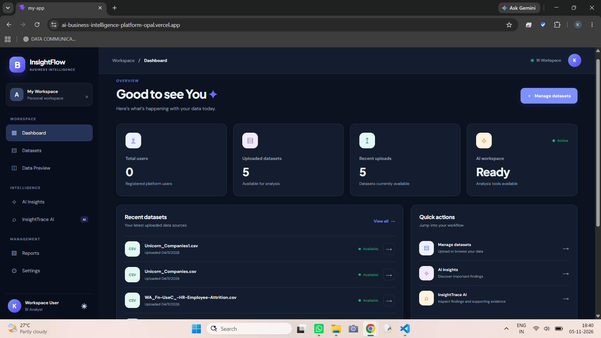
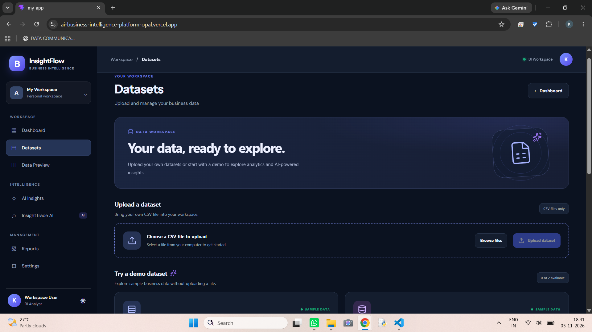
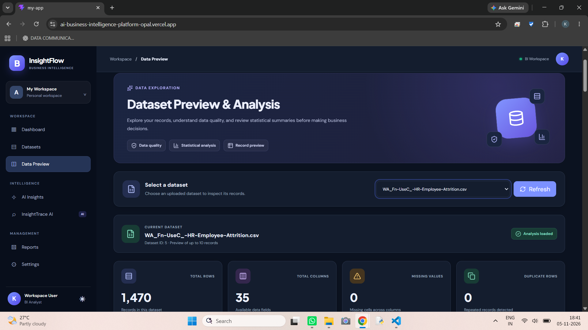
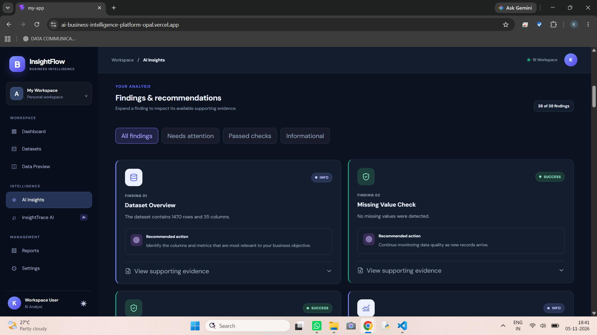
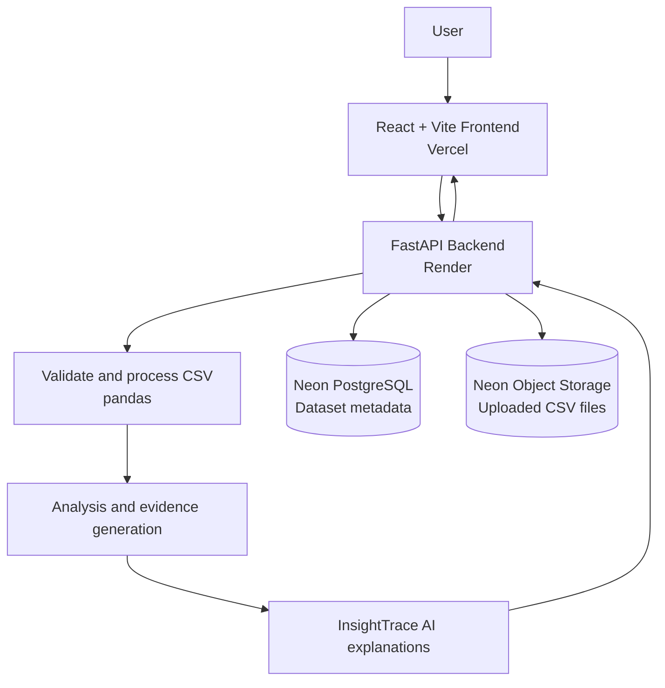

<div align="center">

# ✨ InsightTrace AI

### AI-Powered Business Intelligence Platform

**Turn raw CSV data into clear analytics, evidence-backed findings, and actionable business insights.**

<br />

[](https://ai-business-intelligence-platform-opal.vercel.app/)

<br />

[**Live Website**](https://ai-business-intelligence-platform-opal.vercel.app/) · [**Backend API**](https://ai-business-intelligence-platform-zkre.onrender.com/) · [**API Documentation**](https://ai-business-intelligence-platform-zkre.onrender.com/docs) · [**GitHub Repository**](https://github.com/KavyaRaghuvanshi/AI-Business-Intelligence-Platform)

<br />


</div>

---

## 🚀 Try the Live Application

<div align="center">

### [Launch InsightTrace AI →](https://ai-business-intelligence-platform-opal.vercel.app/)

**Upload a CSV · Explore analytics · Generate insights · Understand the evidence**

</div>

InsightTrace AI is deployed as a full-stack web application. The React frontend is hosted on **Vercel**, the FastAPI backend on **Render**, and uploaded datasets are stored using **Neon PostgreSQL** and **Neon Object Storage**.

| Resource | Link |
|---|---|
| 🌐 Live application | [Open InsightTrace AI](https://ai-business-intelligence-platform-opal.vercel.app/) |
| ⚙️ Backend API | [Open API](https://ai-business-intelligence-platform-zkre.onrender.com/) |
| 📚 Interactive API docs | [Open Swagger UI](https://ai-business-intelligence-platform-zkre.onrender.com/docs) |
| 💻 Source code | [View GitHub repository](https://github.com/KavyaRaghuvanshi/AI-Business-Intelligence-Platform) |

> **First visit:** The backend may need a short moment to become responsive after a period of inactivity. If the first request takes time, refresh the page and try again.

---

## 📸 Application Screenshots

The screenshots below show the main workflow of the application. Add your actual screenshots to `docs/screenshots/` using these filenames; GitHub will render them automatically when the files are committed.
<p align="center">
      <strong>01 · Dashboard</strong><br />
      <br>
      <sub>Workspace overview and navigation</sub>
      </p>
<table>
  <tr>
    <td width="50%" align="center">
      <strong>02 · Dataset Library</strong><br />
      
      <sub>Upload and browse CSV datasets</sub>
    </td>
    <td width="50%" align="center">
      <strong>03 · Analytics</strong><br />
      
      <sub>Explore statistics and data patterns</sub>
    </td>
  </tr>
  <tr>
    <td width="50%" align="center">
      <strong>04 · AI Insights</strong><br />
      
      <sub>Review findings and supporting evidence</sub>
    </td>
    <td width="50%" align="center">
  <strong>05 · InsightTrace AI</strong><br />
  
  <br />
  <sub>Explore explanations and recommendations for analytical findings</sub>
  </td>
  </tr>
</table>


---

## 💡 About the Project

**InsightTrace AI** is a web-based Business Intelligence platform designed to make dataset exploration and analysis more accessible. Users can upload CSV files, inspect records, view statistical analysis, and generate findings from their data. The InsightTrace AI experience adds explanatory context and recommendations to help users interpret those findings.

The project brings together a modern frontend, a Python API, relational database storage, cloud file storage, and an analysis pipeline in one deployed application.

## ✨ Key Features

| Feature | What it does |
|---|---|
| 📂 **CSV dataset upload** | Upload CSV datasets through the web interface. |
| ☁️ **Cloud file storage** | Store uploaded dataset files in Neon Object Storage. |
| 🗃️ **Dataset library** | Retrieve and browse saved dataset records. |
| 👀 **Dataset preview** | Inspect rows and columns before exploring the data. |
| 📊 **Statistical analysis** | Review dataset dimensions, data types, missing values, duplicates, and numeric summaries. |
| 🧠 **AI Insights** | Generate evidence-based findings from the selected dataset. |
| 🔎 **InsightTrace AI** | View explanatory context and recommendations for findings. |
| 📥 **CSV export** | Download the original uploaded dataset. |
| 🔌 **API documentation** | Explore backend endpoints through interactive Swagger UI. |

## 🧭 How It Works



### Dataset workflow

1. **Upload:** The user selects a CSV file in the web application.
2. **Validate:** The FastAPI backend validates the uploaded data.
3. **Store:** The CSV file is saved in Neon Object Storage, while its metadata and storage reference are recorded in Neon PostgreSQL.
4. **Explore:** The user can preview the dataset and request statistical analysis.
5. **Generate insights:** The analysis engine checks data quality, numeric patterns, and potential outliers to produce findings.
6. **Interpret:** InsightTrace AI provides explanatory context and recommendations for the findings.

## 🏗️ Technology Stack

| Layer | Technologies |
|---|---|
| Frontend | React, JavaScript, Vite, CSS, Lucide React |
| Backend | Python, FastAPI, Uvicorn |
| Data processing | pandas |
| Database | Neon PostgreSQL, SQLAlchemy |
| Object storage | Neon Object Storage, S3-compatible API, boto3 |
| Deployment | Vercel, Render, Neon |
| Version control | Git, GitHub |

## 🔌 API Reference

The deployed API includes the following core endpoints. For the complete schema and interactive testing, visit the [Swagger documentation](https://ai-business-intelligence-platform-zkre.onrender.com/docs).

| Method | Endpoint | Description |
|---|---|---|
| `GET` | `/` | Check API availability |
| `GET` | `/dashboard` | Retrieve dashboard summary data |
| `POST` | `/datasets/upload` | Upload a CSV dataset |
| `GET` | `/datasets` | List uploaded datasets |
| `GET` | `/datasets/{id}/preview` | Preview dataset records and columns |
| `GET` | `/datasets/{id}/analysis` | Retrieve statistical analysis |
| `GET` | `/datasets/{id}/insights` | Generate evidence-based findings |
| `GET` | `/datasets/{id}/insighttrace` | Retrieve InsightTrace AI explanations |
| `GET` | `/datasets/{id}/export/csv` | Download the original CSV dataset |
| `GET` | `/storage/health` | Check object-storage connectivity |

Replace `{id}` with the dataset ID returned by `GET /datasets`.

---

## 💻 Run Locally

You can run the frontend and backend locally for development.

### Prerequisites

- Python 3.11 recommended
- Node.js and npm
- Git
- A Neon PostgreSQL database
- A Neon Object Storage bucket with its S3-compatible connection credentials

### 1. Clone the repository

```bash
git clone https://github.com/KavyaRaghuvanshi/AI-Business-Intelligence-Platform.git
cd AI-Business-Intelligence-Platform
```

### 2. Configure and run the backend

```bash
cd backend
python -m venv venv
```

Activate the virtual environment:

**Windows PowerShell**

```powershell
.\venv\Scripts\Activate.ps1
```

**macOS / Linux**

```bash
source venv/bin/activate
```

Install the Python dependencies:

```bash
pip install -r requirements.txt
```

Create a `backend/.env` file and add your own service credentials:

```env
DATABASE_URL=your_neon_postgresql_connection_string

AWS_ENDPOINT_URL_S3=your_neon_s3_endpoint
AWS_ACCESS_KEY_ID=your_neon_storage_access_key_id
AWS_SECRET_ACCESS_KEY=your_neon_storage_secret_access_key
AWS_REGION=your_neon_storage_region
NEON_STORAGE_BUCKET=your_private_bucket_name

CORS_ORIGINS=http://localhost:5173,http://127.0.0.1:5173
MAX_UPLOAD_SIZE_MB=25
```

Use the S3 connection details from the **Neon Object Storage** settings for the endpoint, access keys, and region. The S3 endpoint is different from the PostgreSQL connection hostname.

Start the backend from the `backend` directory:

```bash
python -m uvicorn app.main:app --reload
```

The backend will be available at `http://127.0.0.1:8000` and the interactive API documentation at `http://127.0.0.1:8000/docs`.

### 3. Configure and run the frontend

Open a second terminal and run:

```bash
cd frontend/my-app
npm install
npm run dev
```

Ensure the API base URL in the existing `src/services/api.js` configuration points to your local backend:

```text
http://127.0.0.1:8000
```

Vite will print the local frontend URL in the terminal (commonly `http://localhost:5173`).

### 4. Check object storage

With the backend running and environment variables configured, open:

```text
http://127.0.0.1:8000/storage/health
```

A successful response confirms that the backend can connect to the configured object-storage bucket.

---

## ☁️ Deployment Architecture

| Component | Platform | Responsibility |
|---|---|---|
| Frontend | **Vercel** | Hosts the React application |
| Backend | **Render** | Runs the FastAPI service |
| Database | **Neon PostgreSQL** | Stores application and dataset metadata |
| File storage | **Neon Object Storage** | Stores uploaded CSV files |

Production configuration requires the frontend to use the deployed backend URL, the backend CORS configuration to allow the frontend origin, and database/storage credentials to remain in the backend environment.

## 🔐 Security Notes

- Never commit `.env` files, database URLs, access keys, secret keys, or tokens.
- Keep Neon Object Storage credentials on the backend; do not expose them in frontend code.
- Keep the object-storage bucket private unless your application specifically requires public access.
- Do not commit virtual environments, generated build folders, or private datasets.
- Upload only datasets you are authorized to use.
- Review generated findings in the context of the source data and business requirements before making decisions.

## 🗂️ Project Structure

```text
AI-Business-Intelligence-Platform/
│
├── backend/
│   ├── app/
│   │   ├── main.py                 # FastAPI application and routes
│   │   ├── storage.py              # Neon Object Storage integration
│   │   ├── insight_engine.py       # Evidence and insight generation
│   │   └── ai_explaner.py          # AI explanation logic
│   ├── uploads/                    # Local development upload directory
│   ├── database.py                 # Database connection setup
│   ├── models.py                   # SQLAlchemy models
│   ├── schemas.py                  # API schemas
│   ├── security.py                 # Authentication utilities
│   └── requirements.txt            # Python dependencies
│
├── frontend/
│   └── src/
│       ├── src/
│       │   ├── pages/              # Application pages
│       │   └── services/           # API configuration
│       ├── package.json
│       └── vite.config.js
│
├── docs/
│   └── screenshots/                # README application screenshots
│       ├── 01-dashboard.png
│       ├── 02-dataset-library.png
│       ├── 03-analytics.png
│       ├── 04-ai-insights.png
│       └── 05-insighttrace-ai.png
│
└── README.md
```

## 🛣️ Future Scope

- More interactive and customizable analytics.
- Additional dataset formats and scalable processing.
- Downloadable, presentation-ready insight reports.
- Dataset ownership and access-management improvements.
- Expanded monitoring and storage-usage visibility.

## 👩‍💻 Author

**Kavya Raghuvanshi**  
[GitHub Profile](https://github.com/KavyaRaghuvanshi)

---

<div align="center">

### ⭐ Explore the project

[](https://ai-business-intelligence-platform-opal.vercel.app/)

**InsightTrace AI — From raw data to traceable insights.**

</div>
